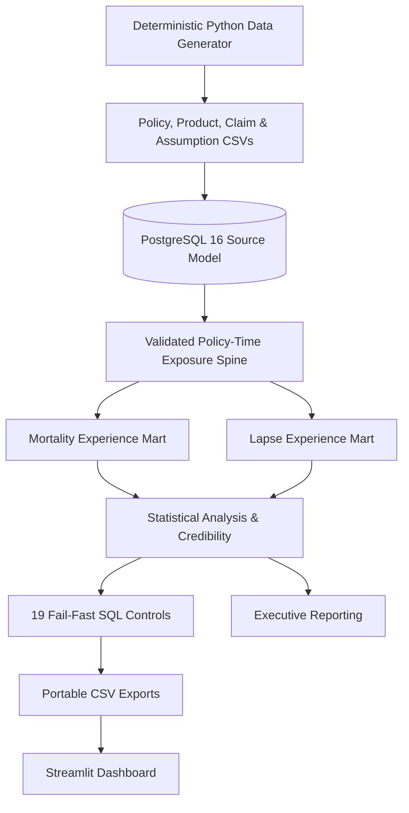

# InsureMetrics – Term-Life Insurance Experience & Portfolio Analytics Engine

An end-to-end actuarial analytics platform that transforms synthetic term-life insurance policy and claims data into validated mortality and lapse insights, credibility-adjusted experience analysis, assumption-review recommendations, and management-ready reporting.

Built using **Python, PostgreSQL, SQL, Streamlit, and Docker**, InsureMetrics demonstrates insurance data engineering, actuarial analytics, statistical validation, business analysis, and evidence-based decision support.

> **Data Disclaimer:** This project uses entirely synthetic insurance data and fictional assumption bases. No real policyholder information is used. The results are intended for educational and portfolio demonstration purposes only.

---

## Executive Summary

InsureMetrics analyzes a synthetic term-life insurance portfolio covering the observation period **2021–2025**, with a total exposure of **63,642.64 life-years**.

### Portfolio Experience Results

| Measure | Actual | Expected | A/E | 95% A/E Interval | Credibility | Review Action |
|---|---:|---:|---:|---:|---:|---|
| Mortality Count | 127 | 113.91 | 111.5% | 92.9%–132.7% | 57.5% | `MONITOR` |
| Mortality Amount | 55.35M | 50.89M | 108.8% | — | — | — |
| Voluntary Lapse | 3,006 | 2,969.82 | 101.2% | 97.6%–104.9% | 100.0% | `MAINTAIN` |

### Key Analytical Findings

**1. Mortality Experience**

- Actual deaths: 127.
- Expected deaths: 113.91.
- Raw mortality A/E: 111.5%.
- Credibility factor: 57.5%.
- Credibility-adjusted A/E: 106.6%.
- 95% confidence interval: 92.9%–132.7%.

The portfolio indicates moderately adverse mortality experience. However, the confidence interval includes 100%, so the available evidence does not establish a sufficiently conclusive basis for an immediate mortality assumption change. The portfolio-level recommendation is `MONITOR`.

**2. Mortality Amount Experience**

- Actual claim amount: 55.35M.
- Expected claim amount: 50.89M.
- Actual-to-expected amount ratio: 108.8%.

**3. Lapse Experience**

- Actual voluntary lapses: 3,006.
- Expected voluntary lapses: 2,969.82.
- Lapse A/E: 101.2%.
- Credibility: 100.0%.
- Recommendation: `MAINTAIN`.

### Targeted Segment Findings

Two segments warrant further investigation:

| Segment | Actual Events | Expected Events | A/E | Lower 95% Bound |
|---|---:|---:|---:|---:|
| TERM10 / 500K–749K Mortality | 16 deaths | 7.91 deaths | 202.3% | 115.6% |
| TERM30 / Duration-1 Lapse | 221 lapses | 187.31 lapses | 118.0% | 102.9% |

These findings identify areas for targeted investigation. They are not independently approved assumption changes or causal conclusions.

For detailed interpretation, see:

- [Executive Memo](docs/executive_memo.md)
- [Assumption Recommendation](docs/assumption_recommendation.md)

---

## Project Objectives

The project demonstrates how insurance policy and claims data can be transformed into structured, validated analytical insights.

Key objectives:

- Generate reproducible synthetic insurance datasets using deterministic seeds.
- Design relational data models for policies, products, claims, assumptions, and studies.
- Calculate policy exposure using calendar-year and policy-anniversary boundaries.
- Handle leap years, leap-day anniversaries, and termination dates.
- Analyze mortality count, mortality amount, and lapse experience.
- Calculate actual-to-expected ratios.
- Apply statistical confidence intervals and credibility adjustments.
- Identify portfolio segments requiring further investigation.
- Implement SQL-based data-quality and reconciliation controls.
- Present findings through an interactive dashboard.
- Translate analytical results into business-oriented recommendations.

---

## What This Project Demonstrates

- Reproducible synthetic insurance data generation.
- Relational database modeling and data loading.
- Fractional calendar-year exposure calculations.
- Policy-anniversary and leap-day handling.
- Mortality count and amount A/E analysis.
- Lapse A/E analysis with competing termination events.
- Calendar trends, issue cohorts, and multidimensional segment diagnostics.
- Poisson uncertainty intervals and limited-fluctuation credibility.
- Rule-based and auditable assumption-review flags.
- 19 fail-fast SQL reconciliation controls.
- Portable CSV result exports.
- Interactive Streamlit dashboard development.
- Business requirements documentation and requirements traceability.
- User acceptance testing and test evidence management.
- Data governance and analytical quality assurance.

---

## Technical Architecture



Every recommendation is designed to be traceable to source data, documented methodology, and validation results.

### Technology Stack

| Layer | Technology | Purpose |
|---|---|---|
| Programming | Python | Synthetic data generation and analytical workflows |
| Database | PostgreSQL 16 | Relational data storage |
| Data Analysis | SQL | Exposure, mortality, lapse, and reconciliation calculations |
| Dashboard | Streamlit | Interactive analytics and reporting |
| Infrastructure | Docker Compose | Database environment management |
| Testing | Python unittest | Generator and reproducibility tests |
| Validation | SQL | Data integrity and analytical controls |
| Version Control | Git and GitHub | Source code and documentation |

---

## Analytical Methodology

### 1. Synthetic Data Generation

The project generates a reproducible synthetic term-life insurance portfolio.

| Dataset | Description |
|---|---|
| Policies | Synthetic policy-level records |
| Products | Term-life insurance product definitions |
| Death Claims | Synthetic death claim records |
| Mortality Assumptions | Fictional mortality rates |
| Lapse Assumptions | Fictional lapse rates |

**Dataset characteristics:**

- 20,000 synthetic policies.
- Observation period: 2021–2025.
- Deterministic data generation using a configurable seed.
- Fictional mortality basis: `LSL_2020_FICTIONAL`.
- Fictional lapse basis: `LSL_2020_LAPSE_FICTIONAL`.

### 2. Exposure Calculation

Exposure is calculated by dividing active policy days by the number of calendar days in the relevant year.

```text
Exposure = Active Policy Days / Calendar-Year Days
```

The calculation accounts for:

- Policy commencement and termination dates.
- Calendar-year boundaries.
- Policy anniversaries.
- Leap-year handling.
- Death-date allocation.
- Exposure segment continuity and overlap checks.

### 3. Mortality Analysis

Expected mortality is calculated using:

```text
Expected Deaths =
    Exposure × Mortality qx

Expected Claim Amount =
    Exposure × Mortality qx × Face Amount

Mortality A/E =
    Actual Deaths / Expected Deaths
```

Mortality analysis includes portfolio-level and segmented experience across documented dimensions, including:

- Calendar year.
- Issue cohort.
- Sex and smoking status.
- Attained age and duration.
- Product and face amount band.
- Issue state.

### 4. Lapse Analysis

Expected lapse experience is calculated using:

```text
Expected Lapses =
    Exposure × Lapse Rate

Lapse A/E =
    Actual Voluntary Lapses / Expected Lapses
```

The analysis distinguishes voluntary lapse events from competing termination events, including death and maturity, according to the documented methodology.

### 5. Statistical Analysis and Credibility

The project uses Poisson-based uncertainty intervals with a Byar approximation for mortality event counts.

The full-credibility standard is based on a 10% relative error at a 95% confidence level.

```text
Full Credibility Standard =
    (1.96 / 0.10)²
    = 384.16

Credibility Factor Z =
    min(1, sqrt(Actual Events / 384.16))

Credibility-Adjusted A/E =
    1 + Z × (Raw A/E - 1)
```

Credibility-adjusted results are interpreted alongside confidence intervals and exposure thresholds.

### 6. Assumption Review Recommendations

The project applies documented decision rules to classify experience segments.

| Review Condition | Recommendation |
|---|---|
| Exposure below 250 life-years OR fewer than 5 actual events | `LOW_CREDIBILITY` |
| Lower 95% bound above 100% AND credibility-adjusted A/E at least 110% | `STRENGTHEN` |
| Upper 95% bound below 100% AND credibility-adjusted A/E at most 90% | `WEAKEN` |
| Credibility-adjusted A/E differs from 100% by at least 5 percentage points | `MONITOR` |
| Otherwise | `MAINTAIN` |

These are project-defined review rules, not universal actuarial standards.

---

## Data Quality and Validation Framework

A major component of InsureMetrics is its SQL-based validation and reconciliation framework.

### Validation Results Recorded in the Dashboard

| Validation Metric | Result |
|---|---:|
| Total SQL Controls | 19 |
| Passed Controls | 19 |
| Failed Controls | 0 |
| Overall Status | `PASS` |

The dashboard screenshot records the validation execution timestamp as **29 August 2026, 11:13:18 UTC**.

### Validation Areas

The implemented controls cover:

- Orphan claim detection.
- Invalid claim date detection.
- Death-policy mismatch checks.
- Invalid exposure checks.
- Study and policy period validation.
- Missing mortality assumption detection.
- Duplicate exposure segment detection.
- Exposure gap and overlap validation.
- Expected death calculation reconciliation.
- Expected claim amount reconciliation.
- Actual claim count and amount reconciliation.
- Mortality dimension result reconciliation.
- Lapse exposure spine validation.
- Expected lapse calculation validation.
- Competing termination validation.
- Lapse result reconciliation.

The 19/19 result refers specifically to the implemented SQL validation controls. It does not establish that all governance controls, UAT cases, or independent reviews have passed.

---

## Interactive Streamlit Dashboard

The dashboard provides a consolidated view of the portfolio's analytical results.

### Dashboard Sections

1. **Executive Summary** – Portfolio-level mortality and lapse metrics.
2. **Mortality Trend** – Calendar-year mortality experience.
3. **Segment Investigation** – Mortality experience across portfolio dimensions.
4. **Lapse** – Actual and expected lapse experience.
5. **Controls** – SQL validation status and reported failures.

The dashboard reads exported CSV results from `data/outputs`, allowing it to run without a live database connection after the study has been executed.

---

## Installation and Setup

### Prerequisites

- Python 3.11 or later.
- Docker Desktop.
- Docker Compose.
- Git.

### 1. Clone the Repository

```bash
git clone https://github.com/Prathmesh717/insuremetrics-term-life-experience-analytics.git

cd insuremetrics-term-life-experience-analytics
```

Replace `YOUR_USERNAME` with your GitHub username.

### 2. Create a Python Virtual Environment

```bash
python3.11 -m venv .venv

source .venv/bin/activate
```

### 3. Install Dependencies

```bash
pip install -r dashboard/requirements.txt
```

### 4. Run the Complete Study

Make sure Docker Desktop is running.

```bash
./scripts/run_study.sh
```

The script performs the documented workflow:

1. Generate the deterministic 20,000-policy dataset.
2. Start PostgreSQL 16.
3. Rebuild the relational schema.
4. Load policies, products, assumptions, and claims.
5. Construct mortality exposure.
6. Calculate mortality diagnostics and governance results.
7. Construct lapse exposure from the validated exposure spine.
8. Calculate lapse diagnostics and governance results.
9. Execute 19 fail-fast validation controls.
10. Export dashboard-ready CSVs.

### 5. Configure Dataset Volume and Seed

The default policy volume and random seed can be overridden:

```bash
POLICY_COUNT=50000 STUDY_SEED=12345 ./scripts/run_study.sh
```

### 6. Launch the Dashboard

```bash
streamlit run dashboard/app.py
```

Open the dashboard:

```text
http://localhost:8501
```

---

## Running Tests

### Python Unit Tests

```bash
python -m unittest discover -s tests -v
```

### SQL Edge-Case Tests

```bash
./scripts/test_sql.sh
```

The SQL test script may rebuild the local database using a small edge-case fixture. After completing the SQL tests, restore the full study dataset:

```bash
./scripts/run_study.sh
```

### Test Coverage

The project includes checks for:

- Deterministic synthetic data generation.
- Source and claim reconciliation.
- Leap-day policy anniversaries.
- Deaths occurring exactly on policy anniversaries.
- One-day exposure at the end of a calendar year.
- Full 2024 leap-year exposure.
- Exposure continuity and overlap.
- Fail-fast behavior for missing mortality assumptions.

UAT execution results are maintained separately in `docs/UAT_Execution_Log.md`. Planned test cases must not be represented as completed tests until their execution and evidence have been recorded.

---

## Business Analysis and Governance Documentation

InsureMetrics also demonstrates business analysis, testing, documentation, and governance practices beyond the technical implementation.

| Document | Purpose |
|---|---|
| [Business Requirements Document](docs/BRD.md) | Business objectives, requirements, rules, and acceptance criteria |
| [UAT Plan](docs/UAT_Plan.md) | User acceptance testing scenarios and procedures |
| [UAT Execution Log](docs/UAT_Execution_Log.md) | Test execution results, defects, and evidence references |
| [Governance Checklist](docs/Governance_Checklist.md) | Data, methodology, technical, and review controls |
| [Methodology](docs/methodology.md) | Exposure, mortality, lapse, and statistical calculations |
| [Data Dictionary](docs/data_dictionary.md) | Dataset fields and definitions |
| [Validation Controls](docs/validation_controls.md) | SQL validation and reconciliation rules |
| [Assumption Recommendation](docs/assumption_recommendation.md) | Experience findings and proposed review actions |
| [Executive Memo](docs/executive_memo.md) | Management-oriented analytical summary |
| [Model Limitations](docs/model_limitations.md) | Model assumptions and analytical limitations |

### Governance and Review Approach

For this portfolio demonstration, the Project Author performed the Data Analyst, Developer, Business Analyst, and QA Reviewer responsibilities.

Actuarial Reviewer and Project Owner responsibilities are proposed for independent review and have not been externally assigned.

The project includes a documented governance self-review framework. A self-review does not constitute independent actuarial validation, external approval, or production readiness.

---

## Repository Structure

```text
insuremetrics-term-life-experience-analytics/
│
├── LICENSE
├── README.md
├── .gitignore
├── compose.yaml
│
├── dashboard/
│   ├── app.py
│   └── requirements.txt
│
├── data/
│   ├── generated/
│   │   ├── policies.csv
│   │   ├── products.csv
│   │   ├── death_claims.csv
│   │   ├── mortality_assumptions.csv
│   │   └── lapse_assumptions.csv
│   │
│   └── outputs/
│       ├── mortality_results.csv
│       ├── lapse_results.csv
│       └── validation_results.csv
│
├── docs/
│   ├── assets/
│   │   └── dashboard-overview.jpg
│   ├── evidence/
│   ├── BRD.md
│   ├── UAT_Plan.md
│   ├── UAT_Execution_Log.md
│   ├── Governance_Checklist.md
│   ├── assumption_recommendation.md
│   ├── data_dictionary.md
│   ├── executive_memo.md
│   ├── methodology.md
│   ├── model_limitations.md
│   └── validation_controls.md
│
├── scripts/
│   ├── export_results.sh
│   ├── run_study.sh
│   └── test_sql.sh
│
├── sql/
│   ├── 01_schema.sql
│   ├── 02_load_data.sql
│   ├── 03_build_exposure.sql
│   ├── 04_mortality_analysis.sql
│   ├── 05_validation.sql
│   ├── 06_build_lapse_exposure.sql
│   └── 07_lapse_analysis.sql
│
├── src/
│   └── generate_data.py
│
└── tests/
    ├── sql/
    └── test_generator.py
```

---

## Known Limitations

This project is a portfolio demonstration and has important analytical limitations:

- All policy, claim, and assumption records are synthetic.
- Mortality and lapse assumptions are fictional.
- Pending claims and IBNR are not modeled.
- Underwriting class, distribution channel, premiums, reinsurance, conversion, reinstatement, and policy changes are outside the current scope.
- Mortality and lapse decrements are not jointly modeled.
- Exposure multiplied by an assumption rate is used as a fractional expected-event approximation.
- Issue-age simplification and duration assumptions may affect segment interpretation.
- Poisson independence and the Byar confidence interval approximation have limitations.
- Credibility rules are project-defined and are not universal actuarial standards.
- Segment-level findings may be affected by small sample sizes and multiple comparisons.
- The project does not provide pricing, reserving, capital, or profitability recommendations.
- No independent actuarial validation or external approval has been obtained.

Refer to [Model Limitations](docs/model_limitations.md) for further details.

---

## Future Enhancements

Potential improvements include:

- Interactive assumption sensitivity analysis.
- Additional mortality and lapse segmentation.
- Automated data-quality reporting.
- More advanced credibility approaches.
- Mortality and lapse trend forecasting.
- Additional product and underwriting dimensions.
- Automated regression testing and CI/CD integration.
- Enhanced dashboard filtering and downloadable reports.
- Independent methodology review and documented approval workflow.

---

## Skills Demonstrated

### Technical Skills

- Python
- PostgreSQL
- SQL
- Relational Database Design
- Data Engineering
- Statistical Analysis
- Streamlit
- Docker
- Git and GitHub

### Business and Analytical Skills

- Business Requirements Analysis
- Requirements Gathering
- Requirements Traceability
- Data Quality Management
- Mortality and Lapse Experience Analysis
- Actual-to-Expected Analysis
- Statistical Interpretation
- Credibility Analysis
- User Acceptance Testing
- Data Reconciliation
- Governance and Evidence Management
- Management Reporting

---

## License

This project is licensed under the **MIT License**. You are free to use, modify, distribute, and adapt the software in accordance with the license terms.

See the [LICENSE](LICENSE) file for the complete license text.

Copyright (c) 2026 Prathmesh Aghor.

---

## Project Disclaimer

InsureMetrics is an independently developed synthetic-data portfolio project intended to demonstrate technical, analytical, and business analysis capabilities.

It is not an insurance company's production system, an approved actuarial model, a regulatory submission, or an independent actuarial opinion. All recommendations are illustrative and require appropriate professional review before real-world use.

---

**InsureMetrics – Turning Insurance Experience Data into Structured Analytical Insights.**